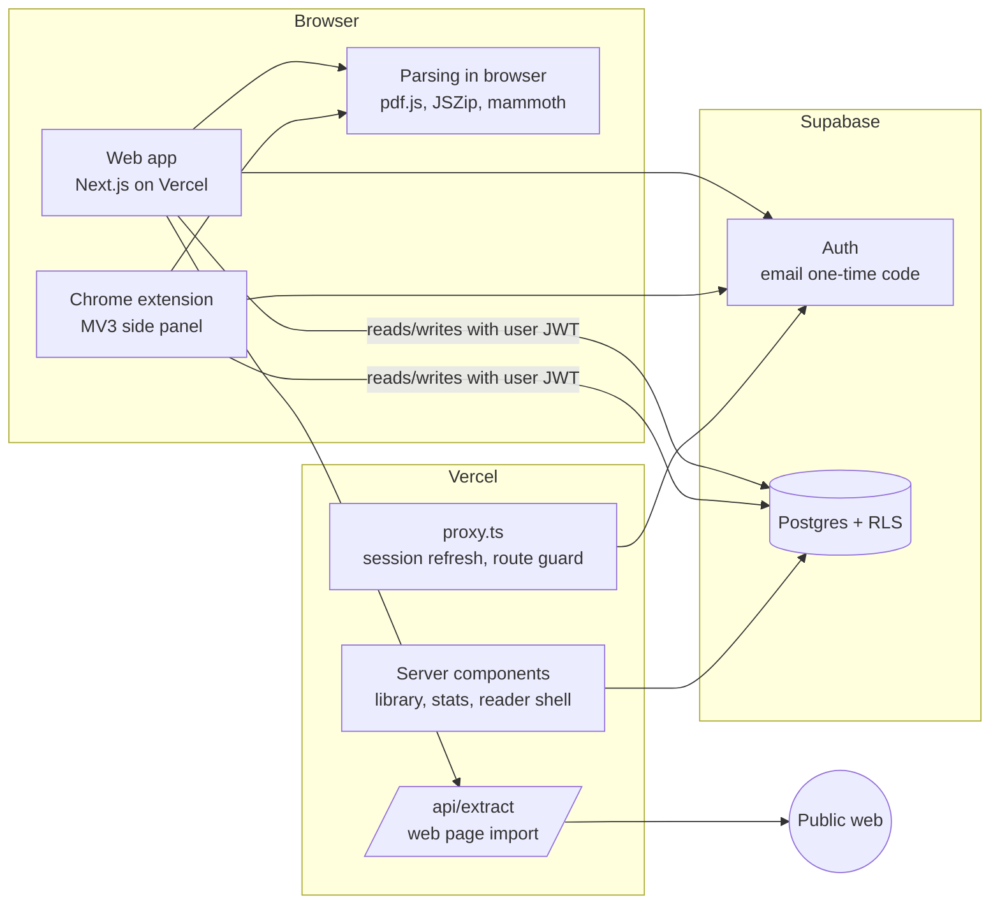

# Architecture

Read Butler is a free RSVP speed reader with two clients, a Next.js web app on Vercel and a Chrome extension, sharing one Supabase backend for auth and data.

## Overview



### Key decisions

| Decision | Why |
| --- | --- |
| **Parse files in the browser.** PDF (pdf.js), EPUB (JSZip + DOMParser), DOCX (mammoth), TXT/Markdown/HTML. | Originals never leave the device. No serverless function has to accept 50 MB uploads (Vercel caps request bodies at 4.5 MB). Same code runs in the extension. |
| **Clients write to Supabase directly**, with the user's JWT, and row level security does authorization. | One data path for web and extension. Large books skip Vercel entirely. No service-role key anywhere in client code. |
| **Store extracted text in Postgres**, in `document_contents`, separate from `documents`. | Transactional with metadata, simple RLS, TOAST compression. Listing the library never loads bodies. Move bodies to Supabase Storage if the database nears its plan limit. |
| **Tokenize on the client, by whitespace.** The `create_document` SQL function counts words with the same rule. | Saved positions are plain word indexes that mean the same thing in every client. |
| **Email one-time code sign-in.** | Works identically in the web app and the extension, which cannot easily receive magic-link redirects. The emailed link also works on the web via `/auth/callback`. |
| **npm workspaces monorepo.** | The reader engine, parsers, React reader component and data layer are written once. |
| **Web page import runs server-side** (`/api/extract`, Readability + linkedom). | Browsers cannot fetch most sites cross-origin. The route is sign-in only and SSRF-guarded. The extension does not need it: it reads the open tab directly. |

## Repository layout

```
apps/
  web/                 Next.js 16 app (Vercel project root)
    src/proxy.ts       Refreshes the Supabase session, guards /library /read /stats
    src/lib/supabase/  Browser, server and proxy clients (@supabase/ssr)
    src/lib/safe-fetch.ts  SSRF-safe fetch for web page import
    src/app/           Pages: / /try /login /library /library/new /read/[id] /stats, /api/extract
  extension/           Chrome MV3 extension (Vite + React)
    public/manifest.json
    src/background.ts  Context menus, opens the side panel, hands text over
    src/sidepanel/     Paste/upload, reader, library, sign-in
packages/
  core/                Framework-free TypeScript
    src/reader/        tokenize, ORP pivot, per-word timing, speed ramp
    src/ingest/        File and text extraction (browser)
    src/data/          Typed Supabase data access shared by both clients
  reader-ui/           React RSVP component and useRsvp hook, plain CSS
supabase/migrations/   Schema, RLS policies, functions
docs/                  This file and the market analysis
```

## Reader engine

- **Tokenizing.** Whitespace split after normalization (line-break hyphenation rejoined, soft hyphens and zero-width characters removed). Paragraph ends are flagged.
- **ORP (optimal recognition point).** The pivot letter sits slightly left of centre (index 0 to 4 by word length, skipping leading punctuation), is drawn in red, and is pinned to the same screen position with a `1fr auto 1fr` grid so the eye never moves.
- **Timing.** Base delay is `60000 / wpm`. Sentence ends get +100%, clause punctuation +50%, paragraph ends +150%, long words up to +50%. The scheduler sets each timeout from the intended time, not from when the last one fired, so drift does not accumulate.
- **Speed training.**
  - *Within a session:* a warm-up ramp starts at `ramp_start_wpm` and adds `ramp_step_wpm` every `ramp_step_words` until it reaches `target_wpm`.
  - *Across sessions:* when a document is finished the reader asks for a 1 to 5 comprehension rating. After at least 300 words, a 4 or 5 raises the target by one step; a 1 or 2 lowers it.
  - Manual speed changes (up/down keys) override the ramp for the rest of the session.
- **Controls.** Space play/pause, left arrow previous sentence, right arrow skip 10, up/down speed, seekable progress bar, and a clickable context view of surrounding text while paused.

## Data model

All tables live in `public`, have RLS enabled, and are owned per user. See `supabase/migrations/20261008000000_initial_schema.sql`.

| Table | Purpose | Notes |
| --- | --- | --- |
| `profiles` | Reader preferences and training settings | Created by trigger on `auth.users` insert. Users may update only the preference columns. |
| `documents` | Library metadata: title, source, word count | Users may only rename (column-level grant). |
| `document_contents` | Extracted text plus `sections` (chapter start indexes) | 3M character cap, about 500k words. Insert requires owning the parent document. |
| `reading_progress` | Last word index and speed per document | Upserted at every checkpoint. |
| `reading_sessions` | One row per sitting: words read, active time, start/end speed, comprehension | Client-generated UUID so repeated checkpoints upsert the same row. |
| `daily_reading_stats` | View: words and effective WPM per day | `security_invoker`, so RLS applies. |

`create_document(...)` inserts metadata and body in one transaction and computes `word_count` server-side. It runs as the caller (`security invoker`), so RLS still applies.

The migration was tested against Postgres (PGlite) with stand-in `auth` objects: users cannot read, claim, overwrite or delete each other's rows, anonymous callers are denied, and deleting a document cascades to its contents and progress while keeping session stats.

### Checkpoints

The reader emits a checkpoint on pause, on finish, every 10 seconds while playing, when the tab is hidden, and on unmount. Each one upserts `reading_progress` and the current `reading_sessions` row. Signed-out extension users get the same checkpoints written to `chrome.storage.local` instead.

## Auth

- Supabase Auth with email one-time codes (`signInWithOtp` then `verifyOtp`).
- **Web:** `@supabase/ssr` keeps the session in cookies. `src/proxy.ts` (Next 16's replacement for middleware) calls `getClaims()` on each request, which refreshes tokens and redirects signed-out visitors away from private pages. Server code always re-checks with `getClaims()` and never trusts `getSession()`.
- **Extension:** `supabase-js` with a `chrome.storage.local` storage adapter, so the session survives the side panel closing. Separate session from the web app; users sign in once in each.
- Later: Google OAuth via `/auth/callback` on the web and `chrome.identity.launchWebAuthFlow` in the extension.

## Chrome extension

- **Manifest V3.** Permissions: `sidePanel`, `storage`, `contextMenus`, `activeTab`, `scripting`. No host permissions: page access comes from `activeTab` only after the user clicks the context menu.
- **Entry points.**
  - The toolbar icon or Alt+Shift+R opens the side panel.
  - Right-click menu: "Speed read selection" and "Speed read this page".
- **Hand-off.** The service worker opens the side panel inside the user gesture, grabs the selection or main page text with `chrome.scripting.executeScript`, and passes it through `chrome.storage.session`. The worker bundle is about 1 KB and contains no parsing code.
- **Signed out:** fully usable. The current document and position are kept locally so closing the panel does not lose your place.
- **Signed in:** "Save to library" stores the document in Supabase. Progress then syncs and the library tab lists everything saved from either client.
- **pdf.js** uses its legacy build in both clients. The modern v6 build calls `Map.prototype.getOrInsertComputed`, which current Chromium does not ship.

## Security notes

- Only the Supabase **publishable** key is shipped to clients. RLS is the authorization layer; every policy uses `(select auth.uid())` for per-statement caching.
- `/api/extract` requires sign-in and blocks private, loopback, link-local, CGNAT and multicast addresses, non-standard ports and URLs with credentials. It re-validates every redirect hop and caps responses at 5 MB with a 10 second timeout. Known gap: DNS rebinding between check and fetch, acceptable on Vercel; pin the resolved IP if that changes.
- Redirect targets after login are restricted to same-site relative paths.
- Responses that set auth cookies get no-store cache headers (handled by `@supabase/ssr`).

## Hosting and cost

| Service | Plan | Limits that matter (check current pricing pages) |
| --- | --- | --- |
| Vercel | Hobby (free) | Non-commercial use only. Function body limit 4.5 MB (irrelevant because uploads bypass Vercel). Move to Pro before charging money. |
| Supabase | Free | About 500 MB database, 50k monthly active users. Free projects pause after a week without activity. The built-in email sender is heavily rate limited; configure custom SMTP (Resend, Postmark, SES) before launch. |
| Chrome Web Store | One-time $5 developer fee | Review takes days. The privacy policy must cover the stored text. |

Rough capacity: an average book is 400 to 600 KB of text, so 500 MB holds on the order of 1,000 books across all users before bodies should move to Storage.

## Setup

### 1. Supabase

1. Create a project.
2. Apply the schema: `npx supabase link --project-ref <ref>` then `npx supabase db push`. Alternatively, paste the migration into the SQL editor.
3. Authentication > Sign In / Providers: enable Email. Under Authentication > Emails, edit the **Magic Link** and **Confirm signup** templates to include the code, for example `Your code is {{ .Token }}`, alongside the link.
4. Authentication > URL Configuration: set Site URL to the production domain and add redirect URLs for `http://localhost:3000/**` and Vercel previews, for example `https://*-<team>.vercel.app/**`.
5. Before launch: custom SMTP and rate limits.

### 2. Web app on Vercel

1. Import the GitHub repo in Vercel and set **Root Directory** to `apps/web`. Vercel installs the npm workspaces from the repo root.
2. Environment variables: `NEXT_PUBLIC_SUPABASE_URL`, `NEXT_PUBLIC_SUPABASE_PUBLISHABLE_KEY`, `NEXT_PUBLIC_SITE_URL`.
3. Deploy. Every PR gets a preview deployment.

### 3. Chrome extension

1. `cp apps/extension/.env.example apps/extension/.env` and fill in the same Supabase values plus `VITE_WEB_APP_URL`.
2. `npm run build:extension`, then load `apps/extension/dist` via chrome://extensions with Developer mode on, using "Load unpacked".
3. To publish, zip `dist/` and upload it to the Chrome Web Store dashboard.

## Roadmap

- **Next:**
  - Google sign-in.
  - Chapter navigation using `sections`.
  - Multi-word chunks (1 to 3 words).
  - Font and theme settings.
  - Generated Supabase types in CI.
  - Playwright tests in CI.
- **Later:**
  - OCR for scanned PDFs (Supabase Edge Function or Tesseract.js in the browser).
  - Moving bodies to Storage at scale.
  - Offline PWA for the web app.
  - Short comprehension quizzes generated from the text.
  - Firefox and Edge builds of the extension (Edge works as is; Firefox needs `sidebar_action`).
